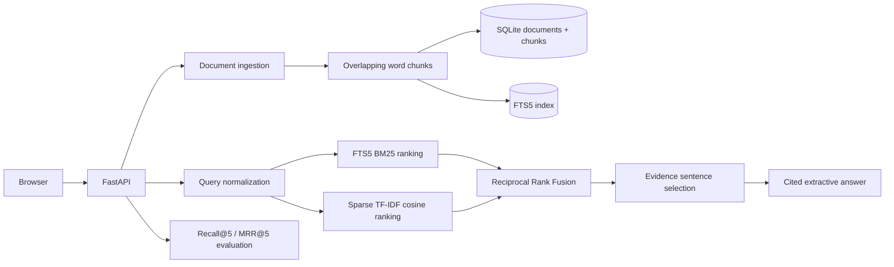

# CiteMesh — Grounded Retrieval & Evaluation Workbench

A fully runnable document ingestion, hybrid retrieval, and evaluation demo. Built with **Python, FastAPI, SQLite FTS5, TF-IDF cosine similarity, and reciprocal rank fusion (RRF)**. Includes a browser interface, a REST API, example engineering documentation, citation-backed **extractive** answers, and a six-query evaluation suite.

**This version is not an LLM chatbot.** It produces verbatim/near-verbatim sentence extracts with source references rather than generative responses. TF-IDF is a sparse text representation, not a dense transformer embedding; the UI and README intentionally distinguish them.

## Architecture



## Run locally (Windows PowerShell)

```powershell
cd citemesh
py -3 -m venv .venv
.\.venv\Scripts\Activate.ps1
pip install -r requirements-dev.txt
python -m uvicorn app.main:app --reload --port 8002
```

Open **http://127.0.0.1:8002** for the live UI and **http://127.0.0.1:8002/docs** for REST API documentation. Requires Python 3.10+; recommended 3.12. For macOS/Linux use `python3 -m venv .venv && source .venv/bin/activate`.

## Explore

1. Search for "How do idempotency keys prevent duplicate orders?" to see answer spans with `[1]`, `[2]` citations from indexed documents.
2. Filter by engineering, AI, or security collections. A citation always points to a stored chunk and original title.
3. Open **Retrieval evaluation** and run the six labeled questions. See **Recall@5** and **MRR@5** with individual ranking positions.
4. Add an engineering runbook with at least 80 characters. Its chunks are indexed immediately. Reuse the title + collection to replace the stored document.

## API

| Method | Endpoint | Description |
|---|---|---|
| `GET` | `/api/state` | Indexed documents, chunk counts, collections |
| `POST` | `/api/documents` | Ingest/upsert and index a bounded document |
| `POST` | `/api/search` | Ranked chunks from BM25 + TF-IDF with RRF |
| `POST` | `/api/answer` | Extractive answer and citation objects |
| `GET` | `/api/evaluation` | Six-question relevance test, Recall@5 / MRR@5 |
| `GET` | `/health` | Service health |
| `GET` | `/docs` | Swagger / OpenAPI explorer |

## Retrieval specifics and honest limitations

- **Ingestion**: chunks at 96 words with 18-word overlap. SQLite FTS5 indexes chunk text; a second sparse TF-IDF cosine ranker runs over scoped chunks. RRF merges two ranked lists with a constant of 60.
- **Grounding**: cited source title, collection, excerpt, chunk ID. Answers are built from selected source sentences, not generated by an LLM.
- **Evaluation**: six hand-labeled queries against eight built-in documents. Metrics reflect only this tiny sample, not a claim of production-grade retrieval performance. Test on a broader held-out dataset before asserting broader accuracy.
- **Document updates**: title + collection form a deterministic ID; an upsert deletes old chunk index entries and inserts new ones in one SQLite transaction.
- **Scope**: no OCR/PDF parsing, no dense vector embeddings, no fine-tuning, no user authentication, no user data isolation. The example uses safe demonstration documents only. Do not label it a secure multi-tenant RAG system.
- **Security**: public document-ingestion APIs are intentionally open for demo. Production requires auth, quotas, content moderation, malware scanning for uploads, and a durable datastore.
- **Hosting**: free Render web services use an **ephemeral filesystem**, so uploaded documents may reset after service sleep or redeploy. Initial seed content returns automatically.

## Tests

```bash
pip install -r requirements-dev.txt
pytest -q
```

Tests validate citation grounding, collection filters, document ingestion and replacement, evaluation bounds, input validation, and insufficient-evidence behavior.

## Publish a public demo

1. Create a new GitHub repository with the **contents of `citemesh/` at its root** and push the code.
2. On [Render](https://dashboard.render.com/), select **New → Web Service**, connect the repository, and choose the Free plan.
3. Build command: `pip install -r requirements.txt`.
4. Start command: `uvicorn app.main:app --host 0.0.0.0 --port $PORT`.
5. Once the service reports success, copy the assigned `https://...onrender.com` URL into the resume or GitHub README. **A public URL has not been assigned in this deliverable.**

## Resume-safe description

**CiteMesh | Python, FastAPI, SQLite FTS5, information retrieval** — Developed a document search API with chunk indexing, BM25 + TF-IDF ranking, reciprocal rank fusion, and citation-backed extractive answers. Added collection filters and a labeled retrieval evaluation suite reporting Recall@5 and MRR@5.

*Personal portfolio project. Claims about production deployment, security, LLM generation or business impact require separate evidence.*
